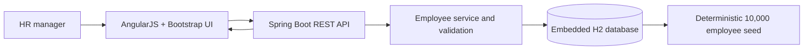

# ACME Salary Management

Small, locally runnable HR salary-record application for a 10,000-person global workforce. See [REQUIREMENTS.md](REQUIREMENTS.md) for goals, scope, and exclusions.

## Project artifacts and approach

- **Requirements:** [REQUIREMENTS.md](REQUIREMENTS.md) captures the goal, HR-manager scope, deliberate exclusions, and success criteria. It was written before implementation.
- **Architecture:** the diagram below shows the request path. Spring Data JPA performs paging and grouped aggregates in H2; AngularJS calls the REST API and renders the results.
- **Trade-offs:** Spring Boot 2.7 is used to remain compatible with Java 8. Embedded, in-memory H2 and deterministic sample data make the app easy to run and test, but data is lost on shutdown and this is not a production persistence setup. AngularJS and Bootstrap are loaded from CDNs to avoid a separate frontend build; the UI therefore needs internet access.
- **Currency correctness:** payroll and average salary are grouped by currency, including in country summaries. The app deliberately does not convert or combine unlike currencies.
- **Performance:** employee search and filters use database queries with bounded pagination (25 records by default, at most 100 per request), rather than sending the full directory to the browser. Dashboard totals are aggregated by the database. Seed inserts are batched in groups of 500. This is designed for the stated 10,000-record demonstration dataset; no production load benchmark is claimed.
- **Validation artifacts:** `mvn test` runs focused service unit tests and API integration tests for seed size, search, paging, summaries, CRUD, validation, duplicates, and request bounds.
- **AI prompts/instructions:** no prompt transcripts or private tool instructions are included in the repository. The requirements document and this implementation summary describe the task scope and engineering decisions.



## Java class guide

Production classes are in `src/main/java/com/acme/salary/`:

- **`SalaryManagementApplication`** — Spring Boot entry point. Starts the application and wires its components.
- **`Employee`** — JPA entity and API representation of one employee salary record. Declares employee details, salary fields, database constraints, and Bean Validation rules.
- **`EmployeeRepository`** — Spring Data JPA persistence and query layer. Reads and writes employees, performs filtered paginated search, provides country/department options, checks uniqueness, and calculates grouped payroll summaries in the database.
- **`EmployeeService`** — business-logic layer between the API and repository. Normalizes identifiers and currency, enforces duplicate checks, coordinates CRUD, and builds dashboard results.
- **`EmployeeController`** — REST API routes under `/api`. Validates and bounds paging/sorting requests, delegates employee operations to the service, and returns dashboard and metadata responses.
- **`ApiExceptionHandler`** — converts validation, bad-request, missing-record, and duplicate/conflict exceptions into useful HTTP status codes and JSON error bodies.
- **`DuplicateEmployeeException`** — explicit domain exception raised when an employee number or email is already in use.
- **`DashboardSummary`** — response DTO containing overall headcount plus payroll summaries by currency and country.
- **`SalaryGroupSummary`** — response DTO for one currency or country/currency group, including headcount, total payroll, and average salary.
- **`EmployeeMetadata`** — response DTO containing the country, department, and currency options used by the UI filters and employee form.
- **`EmployeeSeedData`** — startup seeder. If the database is empty, generates exactly 10,000 deterministic demo employees and saves them in batches.

Test classes are in `src/test/java/com/acme/salary/`:

- **`EmployeeApiIntegrationTest`** — verifies the application/API end to end, including seed size, search and pagination, salary summaries, CRUD, validation, duplicates, and request bounds.
- **`EmployeeServiceTest`** — unit tests service behavior in isolation, including normalization, duplicate rejection, search-filter handling, and updates for missing/existing records.

## Run

Requires Java 8 or later and Maven 3.6 or later.

```sh
mvn spring-boot:run
```

Open [http://localhost:8080](http://localhost:8080). The first startup creates an in-memory H2 database and inserts 10,000 deterministic sample employees. The database resets when the application stops. Sample email addresses use the reserved `.example` domain.

AngularJS 1.8 and Bootstrap 5 are loaded from public CDNs; an internet connection is required to load the interface assets.

## API

- `GET /api/employees?search=&country=&department=&page=0&size=25&sort=lastName&direction=asc` — filtered, sorted, paginated directory (maximum page size 100)
- `GET /api/employees/{id}`, `POST /api/employees`, `PUT /api/employees/{id}`, `DELETE /api/employees/{id}` — salary-record CRUD
- `GET /api/dashboard` — headcount and payroll/average salary by currency and by country+currency
- `GET /api/metadata` — available country, department, and currency values

Salary inputs are positive annual amounts. Currency is an ISO-style three-letter code selected from the supported currencies. Summaries do not convert or combine currencies.

## Test

```sh
mvn test
```

The integration tests exercise deterministic seed size, filtered paging, currency-safe dashboard aggregates, CRUD, validation, duplicates, and sort/page bounds.
